# llm-infra

Terraform + Ansible to spin up a private GPU inference server on GCP. Runs [vLLM](https://github.com/vllm-project/vllm)
behind a WireGuard VPN, exposes an OpenAI-compatible API, and is reachable from nothing on the public internet except
the VPN port.

Everything is parameterised, the playbook is idempotent, and the whole thing from
`terraform apply` to a working API endpoint takes about fifteen minutes (plus however long the model takes to download).

---

## Stack

| Layer          | Tool            |
|----------------|-----------------|
| Infrastructure | Terraform + GCP |
| Configuration  | Ansible         |
| Inference      | vLLM (Docker)   |
| VPN            | WireGuard       |
| OS             | Ubuntu 22.04    |



---

## Prerequisites

**Local tools:**

- [Terraform](https://developer.hashicorp.com/terraform/install) >= 1.5
- [Ansible](https://docs.ansible.com/ansible/latest/installation_guide/) >= 2.14
- [gcloud CLI](https://cloud.google.com/sdk/docs/install)
- WireGuard (`brew install wireguard-tools` on macOS, `apt install wireguard` on Linux)
- `ansible-galaxy collection install community.docker`
  **GCP setup:**

1. Create a project and enable billing:

```bash
gcloud projects create my-llm-project --name="LLM Infra"
gcloud config set project my-llm-project
```

Then go to the [GCP Console](https://console.cloud.google.com) and enable billing on the project — nothing works without
it.

2. Enable the Compute API:

```bash
gcloud services enable compute.googleapis.com iam.googleapis.com
```

3. Authenticate Terraform:

```bash
gcloud auth application-default login
```

4. Request GPU quota. Go to **IAM & Admin -> Quotas** in the console, search for your GPU type, set the value to `1` for
   your target region, and submit. GPU quota is zero by default on new projects.

| GPU       | Quota name              |
|-----------|-------------------------|
| A100 40GB | `NVIDIA_A100_GPUS`      |
| A100 80GB | `NVIDIA_A100_80GB_GPUS` |
| L4        | `NVIDIA_L4_GPUS`        |
| T4        | `NVIDIA_T4_GPUS`        |
 
---

## Deploy

### 1. Provision

```bash
cd terraform
cp terraform.tfvars.example terraform.tfvars
# fill in project_id, zone, machine_type, gpu_type, your home IP, etc.
nano terraform.tfvars
 
terraform init
terraform plan
terraform apply
```

Grab the `instance_ip` from the output.

### 2. WireGuard keypair

Generate a client keypair locally before running Ansible — you need to put the public key into `group_vars/all.yml` so
the server knows about your client.

```bash
wg genkey | tee ~/.wireguard/client_private.key | wg pubkey > ~/.wireguard/client_public.key
chmod 600 ~/.wireguard/client_private.key
cat ~/.wireguard/client_public.key
```

### 3. Configure Ansible

```bash
cd ansible
cp inventory/hosts.ini.example inventory/hosts.ini
# paste the instance IP
nano inventory/hosts.ini

# set vllm_model, vllm_api_key, huggingface_token, wireguard_peers
nano group_vars/all.yml
```

For `vllm_api_key` and `huggingface_token`, use ansible-vault or pass them as environment variables. Don't commit real
values.

```bash
ansible-vault encrypt_string 'hf_...' --name 'huggingface_token'
# paste the output into group_vars/all.yml
```

### 4. Run

The playbook will reboot the instance mid-run to load the NVIDIA kernel module, then reconnect and finish.

```bash
ansible-playbook -i inventory/hosts.ini site.yml
# or with vault:
ansible-playbook -i inventory/hosts.ini site.yml --ask-vault-pass
```

---

## Connect

After the playbook finishes, a ready-to-import WireGuard config is written to `wireguard-clients/<name>.conf`. The
server's public key and endpoint are already filled in, you just need to paste your client private key into the
`PrivateKey` field.

```bash
nano wireguard-clients/laptop.conf
# paste contents of ~/.wireguard/client_private.key

# Linux:
sudo cp wireguard-clients/laptop.conf /etc/wireguard/wg-llm.conf
sudo wg-quick up wg-llm

# macOS / iOS / Android: import via the WireGuard app
```

Verify: `ping 10.8.0.1`

---

## Use the API

Once on VPN, the endpoint is at `http://10.8.0.1:8000/v1`.

```bash
curl http://10.8.0.1:8000/v1/models \
  -H "Authorization: Bearer YOUR_API_KEY"
```

```python
from openai import OpenAI

client = OpenAI(base_url="http://10.8.0.1:8000/v1", api_key="YOUR_API_KEY")
response = client.chat.completions.create(
    model="meta-llama/Meta-Llama-3-8B-Instruct",  # whatever you set for vllm_model
    messages=[{"role": "user", "content": "Hello"}],
)
```

---

## Changing models

Edit `vllm_model` in `group_vars/all.yml` (and `vllm_max_model_len` if needed), then re-run the playbook. The service
restarts with the new model; weights download on first start and are cached at `vllm_model_cache_dir` for subsequent
runs.

---

## Teardown

```bash
cd terraform && terraform destroy
```

---

## Design notes

- vLLM binds to `10.8.0.1` (the WireGuard interface), not `0.0.0.0`, so it's unreachable from the public internet.
- The firewall exposes exactly two things: the WireGuard UDP port (world) and SSH.
- CUDA is installed from the NVIDIA network apt repo.
- vLLM runs as a systemd service.